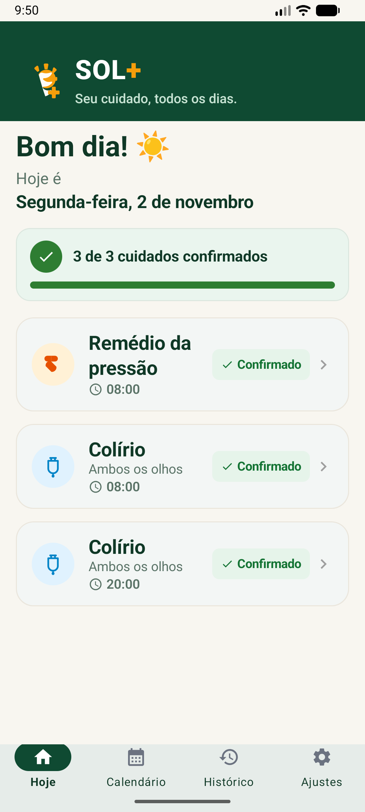
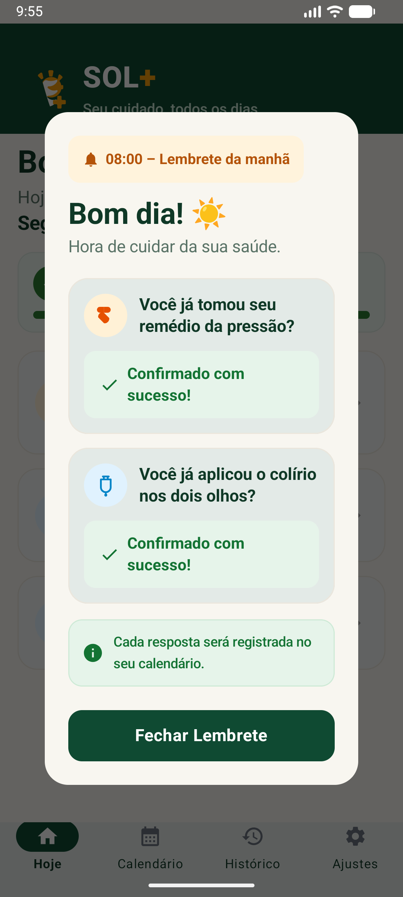
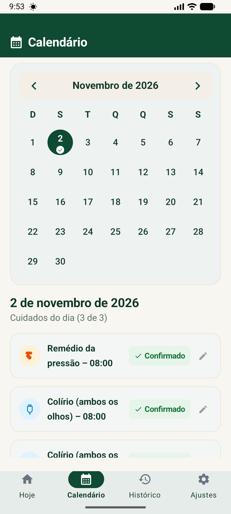
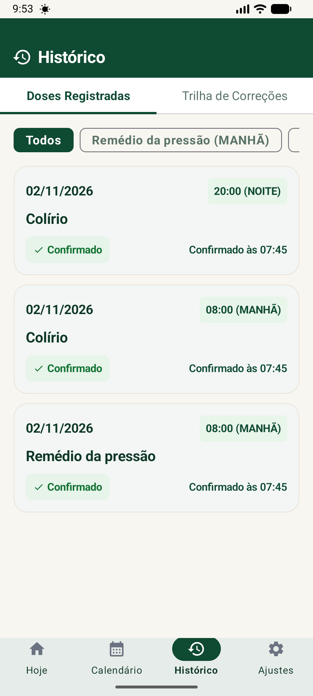

# SOL+

Eu desenvolvi o SOL+ como meu primeiro projeto acadêmico em Análise e Desenvolvimento de Sistemas (ADS). É um aplicativo Android nativo e offline para organizar lembretes e registrar uma rotina de cuidados com medicamentos, com foco em simplicidade, legibilidade e confirmações independentes.

> **Projeto educacional:** o SOL+ contém limitações conhecidas e não substitui orientação médica, prescrição, cuidador ou dispositivo clínico. O aplicativo não deve ser usado como única barreira contra uma dose perdida ou duplicada.

## Demonstração

| Início | Lembrete da manhã |
|---|---|
|  |  |

| Calendário | Histórico |
|---|---|
|  |  |

As imagens foram geradas em emulador com dados de demonstração. Dados reais, backups, bancos, logs brutos e identificadores de dispositivo não fazem parte deste repositório.

## O que eu implementei

- organização de três lembretes diários configurados no aplicativo;
- confirmações independentes para cada cuidado;
- opções para confirmar, adiar, registrar incerteza e corrigir o histórico;
- calendário, histórico e trilha de correções;
- notificações locais e reagendamento após reinicialização ou mudança de horário;
- armazenamento local, sem conta e sem API remota;
- tela de diagnóstico para permissões e restrições de bateria.

## Tecnologias e ferramentas

- Kotlin 2.0 e Java 17;
- Jetpack Compose e Material 3;
- arquitetura próxima de MVVM, com ViewModels, coroutines e Flow;
- Room para persistência e DataStore para preferências;
- AlarmManager e notificações Android;
- Gradle Wrapper 8.7 e Android Gradle Plugin 8.5.2;
- JUnit 4, AndroidX Test, Espresso e Compose UI Test;
- Android Lint, Android Emulator, ADB, `aapt` e `apksigner` no processo de validação.

## Como executar

Pré-requisitos: JDK 17 e Android SDK 34 configurados. Crie seu próprio `local.properties` apontando para o SDK; esse arquivo é privado e está ignorado pelo Git.

```powershell
.\gradlew.bat testDebugUnitTest lintDebug assembleDebug
```

O APK de desenvolvimento será criado em `app/build/outputs/apk/debug/`. APKs e AABs não são versionados. Para instalar em um dispositivo conectado, use o ADB do Android SDK:

```powershell
& "$env:LOCALAPPDATA\Android\Sdk\platform-tools\adb.exe" install -r ".\app\build\outputs\apk\debug\app-debug.apk"
```

Não há chave de distribuição no repositório. A variante `release` deve ser assinada somente fora do Git, com credenciais locais ou segredos protegidos do CI.

## Testes e estado atual

O projeto contém 28 testes JVM e 10 testes instrumentados. Registrei a verificação reproduzida desta versão em [docs/TESTING.md](docs/TESTING.md).

Ainda preciso concluir testes físicos no Xiaomi/HyperOS, especialmente para alarmes em segundo plano, reinicialização, economia de bateria, tela bloqueada, TalkBack e escala máxima de fonte. Uma compilação aprovada não comprova segurança clínica nem garante a entrega pontual de alarmes em todos os aparelhos.

## Limitações conhecidas

- a rotina e os textos foram desenhados para um caso de uso específico, não para prescrições gerais;
- não há sincronização em nuvem nem recuperação automática após desinstalação;
- a restauração de backup está desativada na interface por segurança;
- a variante release ainda não possui assinatura de distribuição;
- a arquitetura de módulo único e a injeção manual de dependências ainda podem evoluir;
- a acessibilidade precisa de validação humana contínua em aparelho real;
- políticas de bateria de fabricantes podem atrasar notificações.

Veja também [arquitetura](docs/ARCHITECTURE.md), [segurança e privacidade](docs/SECURITY.md), [testes](docs/TESTING.md), [próximos passos](docs/ROADMAP.md) e o [checklist de publicação](docs/PUBLICATION_CHECKLIST.md).

## Desenvolvimento com apoio de IA

Eu defini o problema, os objetivos, os requisitos e as decisões do produto. Também revisei o código, executei testes e decidi o que faria parte da versão publicada.

Durante o desenvolvimento, usei ferramentas de inteligência artificial como apoio para pesquisa, implementação, revisão, testes e documentação. A IA funcionou como uma ferramenta de auxílio ao meu aprendizado e ao processo de desenvolvimento; a direção do projeto, a avaliação dos resultados e a responsabilidade pela publicação são minhas.

## Licença e uso

Este projeto está disponível publicamente para apresentação e avaliação de portfólio. Nenhuma licença de código aberto foi concedida. Permanecem reservados os direitos autorais aplicáveis; entre em contato antes de reutilizar, modificar ou distribuir o código.
